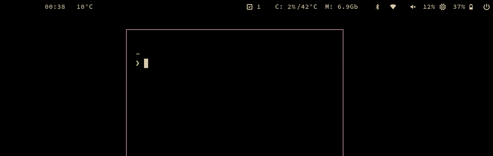

# hyproled

Hyprland shader utility to prevent OLED burn in. Blacks out one of every four pixels and rotates the off pixel through the 2x2 block, so the pattern stays bright while every pixel gets a rest.



## Usage

```
Usage: hyproled [OPTION]... [off]

Options:
  -a x:y:w:h  The effective area. Useful for bars. [Default: The entire screen]
  -i          Inverts the area. Useful for focus effect of a window or popup.
  -o N        How many pixels of each 2x2 block are turned off (1-3). [Default: 1]
  -s          Swap the off pixels to the next of 4 positions. Useful to prevent
              burn in, when called periodically (e.g. every 15 minutes).
  -m ID       Id of your oled monitor (hyprctl monitors). [Default: 0]
  -h          Display this help message.

Argument:
  off         Disable hyproled
```

## Install

1. Using AUR package [hyproled-git](https://aur.archlinux.org/packages/hyproled-git)

`yay -S hyproled-git`

or

2. `sudo cp hyproled /usr/bin/hyproled`

## Getting Started

Executing `hyproled` will overlay the entire screen with a pattern that turns off 1 of every 4 pixels (a 2x2 block). This keeps 75% of the brightness instead of 50% with a classic checkerboard. Use `-o N` to turn off more pixels of each block, e.g. `-o 2` for the old 50% checkerboard feel. The maximum is 3, since `-o 4` would turn off every pixel and make the display unusable.

Since the effect still reduces the overall brightness, it might make sense to apply the shader only partially on highly static areas such as bars.

```bash
hyproled -s -a 0:0:2880:50
```

Each time this command is executed it swaps the off pixel to the next of the 4 positions inside its 2x2 block, so one full rotation completes after 4 calls. A great way to prevent burn in is to call hyproled in a cronjob every 15 minutes.

```bash
*/15 * * * * hyproled -s -a 0:0:2880:50
```

Check the [examples](examples) for a more advanced burn in prevention script

## Disable in fullscreen apps

Especially when limiting hyproled to a specific area, it might make sense to disable the shader in fullscreen mode.

```bash
#!/usr/bin/env bash

function handle {
  case $1 in
    'fullscreen>>1') hyproled off ;;
    'fullscreen>>0') hyproled -a 0:0:2880:50 ;;
  esac
}

socat -U - UNIX-CONNECT:$XDG_RUNTIME_DIR/hypr/$HYPRLAND_INSTANCE_SIGNATURE/.socket2.sock | while read -r line; do handle "$line"; done
```

## Development & Deployment

For maintainers: This repository includes an automated deployment workflow for releasing new versions.

See [`.github/DEPLOYMENT.md`](.github/DEPLOYMENT.md) for detailed instructions on:
- Using the GitHub Actions workflow to create releases
- Deploying to AUR (Arch User Repository)
- Setting up required secrets and permissions

## Backlog

- Multiple areas
- Multiple monitors
- Combine with a passed shader, since hyprland allows only one shader
